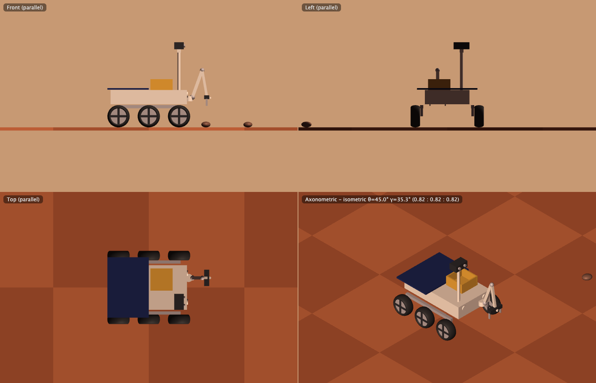

# Project 2 - Planetary Rover
Version Draft 0.1 (Nov 2026)



## Change Log

- Draft 0.1 - initial version, for review before release.

## Introduction

Robots exploring other planets cannot be driven in real time: a command
takes minutes to arrive. They are instead driven from the ground in short,
planned steps, with operators working out on a model of the rover, before
anything moves, where each wheel, joint and camera will end up. That model
is a **hierarchy** of parts: the arm hangs from the body, the wrist from the
arm, the gripper from the wrist. Move the body and everything it carries
moves with it; turn the shoulder and the whole rest of the arm follows.

This project asks you to build such a rover - six wheels, a camera mast and
an arm with a gripper - and drive it around a rocky plain collecting rock
samples into a bin on its deck. It brings together the three topics of the
second half of the semester:

1. **Hierarchical modelling**, and in particular moving points between the
   coordinate systems of different parts. Dropping a rock in the bin is a
   question about where the gripper is *as seen from the bin*, not about
   where it is in the world.
2. **Projections**: the rover is shown in front, left and top views and in
   a fourth view from a direction of the user's choice, either in parallel
   projection (axonometric, for the fourth view) or in perspective.
3. **Illumination**: in the second part of the project the scene is lit by
   the Phong model, with a sun that you can move across the sky and, at
   night, lamps carried by the rover itself.

Project 2 replaces two separate projects from previous years: one on
modelling and projections, another on illumination. It is designed to be
built in that order, and the work plan below follows it.

## Objective

Build a WebGL2 application that shows a planetary rover on a flat, rocky
ground, and that lets the user:

- drive the rover, steering its corner wheels, with the wheels turning as it
  moves;
- move each joint of the arm and of the camera mast, within limits;
- grab a rock with the gripper, carry it, and drop it in the sample bin or
  back on the ground;
- view the scene in four views at once or in any one of them, in parallel
  or in perspective;
- light the scene with a sun and with lamps on the rover, using the Phong
  illumination model.

## Startup code

The folder `src/prjs/prj2-startup` in the course repository has a starting
point for the project. Copy it to `src/prjs/prj2` and work on the copy, as
you did for Project 1.

It sets up a canvas that fills the browser window and draws, in flat
colours and in a single view, a small example scene: a tile of ground and a
turret with an arm, which keys `q` and `e` turn. The keyboard and mouse
wheel are already wired up, with keys that act while held kept apart from
those that act once.

`scenegraph.js` already has the basics of the scene graph described below:
building nodes and leaves, a node's own transformation, finding a node by
name, and the traversal that draws the whole graph with the matrix stack.
What is missing from it is the subject of
[Changing coordinate systems](#changing-coordinate-systems): world matrices,
the way back from world coordinates, and moving a node to a new parent.
The rover, the views and all lighting are yours to write.

You may use any of the libraries in `src/libs` - in particular `MV.js`,
`stack.js`, `utils.js`, `dat.gui.module.js` and the primitive objects in
`libs/objects` (cube, sphere, cylinder, pyramid, torus, bunny, cow). You
may not use any other external library.

## The scene

- **Ground.** A flat ground at $y = 0$, at least 40 m × 40 m, made of a
  chequered pattern of flat cubes (tiles), so that movement over it is easy
  to see.
- **Rock samples.** At least 8 small rocks scattered on the ground: spheres
  scaled to different sizes and shapes, each resting on the ground, small
  enough for the gripper to hold (around 0.2 to 0.4 m).
- **Obstacles and landmarks** (optional, but they help in perspective): a
  few larger boulders, the lander the rover came from.

The rover starts at the origin, facing $+X$. Use metres as units: the
rover's body is about 2.5 m long and its deck about 1 m above the ground.
Your design is free, within the requirements below; the figures show one
possible design.

## The rover

The rover must include at least the following parts, each built from one or
more primitives:

| Part | Degrees of freedom |
|---|---|
| Body | Moves over the ground and turns around $Y$ (driving) |
| Six wheels | Each turns around its axle as the rover moves |
| Four corner wheels | Also turn around $Y$ to steer (the middle two do not) |
| Mast with a camera head | Pan (around the mast) and tilt |
| Arm | A turret turning around $Y$, then shoulder, elbow and wrist |
| Gripper | Two fingers that open and close |
| Sample bin | An open box on the deck, fixed to the body |

Requirements:

- **Limits.** Every joint has limits that make sense for the design: the
  shoulder does not go through the deck, the camera does not tilt to look at
  its own mast from the inside. Steering is limited to about ±35°.
- **Rolling.** The wheels must turn by the right amount: a wheel of radius
  $r$ that travels a distance $s$ turns by $s / r$ radians. Make each wheel
  visibly asymmetric (spokes, a hub, a mark) so that its turning shows.
- **Steering.** With corner steering, the front wheels turn by the steering
  angle $\delta$ and the rear wheels by $-\delta$, and the rover turns about
  a point level with its middle wheels. If $b$ is the distance from the
  middle axle to the front axle and $v$ the speed, its heading changes at
  $\omega = v \tan(\delta) / b$ radians per second.
- **Primitive count.** At least 25 primitives in the rover alone, not counting
  the ground and the rocks.

## Scene graph

Organise the whole scene - ground, rocks and rover - as a **scene graph**:
a JavaScript object that a generic function traverses to draw it. The
startup code has one, and the traversal; extend it as you need.

- An **internal node** has a transformation and a list of children.
- A **leaf** has a transformation and a primitive (a geometry and a
  material).
- Each node stores a scale, three rotations (around $X$, $Y$ and $Z$, in
  degrees) and a translation, applied to a point $P$ in the order

  $$ T \cdot R_z \cdot R_y \cdot R_x \cdot S \cdot P $$

- Nodes have **names**, so that the program can find them (to change a joint
  angle from a key, for example) without knowing where they are in the
  graph.

## Changing coordinate systems

Every node of the graph defines a coordinate system. Its **world matrix** -
the product of its own transformation with those of all its ancestors, from
the root down - takes points from that coordinate system to the world's:

$$ M_{\text{world}}(n) = M(\text{root}) \cdots M(\text{parent}(n)) \cdot M(n) $$

and its inverse takes them back. These two operations, *local to world* and
*world to local*, are the core of this project. Use them for the following
two features, one in each direction.

### Grabbing a rock

Place a node, with no primitive of its own, at the point between the
fingers where a rock would be held - call it the *tool*. When the user
closes the gripper (`p`), find where the tool is in the world: the origin of
its coordinate system, taken to world coordinates by its world matrix.
A rock lying on the ground is a child of the root, so the translation of its
node is where its centre is in the world. The rock nearest to the tool can
be grabbed if its centre is close enough (for example, less than 0.25 m
away).

A grabbed rock must follow the gripper from then on. Move it in the graph so
that it becomes a **child of the tool**, and set its translation to zero:
it snaps to the middle of the fingers. Keep its scale, so that it keeps its
size and shape.

### Dropping it in the bin

When the gripper opens (`p` again), take the tool's position, in world
coordinates, into the **bin's** coordinate system. There, the question
"is the gripper over the bin?" is easy - is the point within the box? - while
in the world's coordinates it is awkward, since the bin moves and turns with
the rover.

- If it is within the bin, move the rock under the bin, so that it travels
  with the rover, and place it on the bin's floor, below that point (in the
  bin's coordinates).
- Otherwise, move it back under the root, and place it on the ground right
  below the tool (in world coordinates).

Rocks in the bin may stay there for good. Show on screen how many samples
are in the bin.

## Views and projections

The application shows either four views at once, splitting the window into
four equal viewports, or any one of them on the whole window:

1. **Front**, **left** and **top** views (the *main views*), laid out as in
   first-angle (European) projection: the left view to the right of the
   front view, the top view below the front view.
2. A **fourth view**, looking at the rover from a direction given by two
   angles, $\theta$ (around $Y$) and $\gamma$ (around $X$). In parallel
   projection it is an **axonometric** view, with presets for isometric,
   dimetric and trimetric. Show which of the three the current angles give.

Every view uses a parallel projection by default, and key `9` switches all
of them to perspective and back. Each view keeps its eye and the direction
it looks in: in perspective, the fourth view is no longer axonometric, just
a perspective view from the direction given by $\theta$ and $\gamma$. When
the views switch, the scale should stay about the same: with a fixed field
of view (45° is a good choice), move the eye to the distance at which, at
the rover, the perspective view shows what the parallel view did.

Requirements:

- **Centred on the rover.** The views look at the rover wherever it drives.
- **Zoom** with the mouse wheel, in every view.
- **No distortion** when the window is resized: each projection uses the
  aspect ratio of its own viewport.
- **Label** each view with its name and projection and, for the fourth
  view, its parameters.
- **Display modes.** Wireframe, solid, or both (solid with the wireframe on
  top).

## Illumination


The first part of the project can be built with each primitive drawn in a
flat colour. The second part replaces that with the **Phong illumination
model**:

$$
\mathbf{I} = \sum_{l=1}^{L} \mathbf{I}_{a,l}\, \mathbf{K}_a + \mathbf{I}_{p,l} \left[ \mathbf{K}_d\, (\mathbf{N} \cdot \mathbf{L})^+ + \mathbf{K}_s\, {(\mathbf{R} \cdot \mathbf{V})^+}^n \right]
$$

evaluated in camera coordinates, per fragment (**Phong shading**).

Every primitive has a **material** ($\mathbf{K}_a$, $\mathbf{K}_d$,
$\mathbf{K}_s$ and shininess $n$). Use different materials for the
different parts of the rover (metal, paint, solar panel, tyres) and for the
ground and the rocks. The user must be able to change the material of the
rover's body through the interface.

The scene has, at least, the following lights:

- **The sun**, a directional light. Its direction is given in world
  coordinates by an elevation and an azimuth that the user can change. The
  shaders want it in camera coordinates: transform it by the view matrix of
  each view, as a direction ($w = 0$).
- **Two headlights**, spotlights on the front of the body, pointing ahead and
  slightly down.
- **A work light** on the wrist, a spotlight pointing where the gripper
  points.

The lamps are **attached to nodes** of the rover. Each one is described by a
position and a direction in its node's coordinate system, which never
change; before each view is drawn, they are taken to camera coordinates by
the view matrix times the node's world matrix. That is why they follow the
rover and the arm without any extra code.

A **spotlight** has, besides its position, an axis, an aperture angle and a
cutoff exponent $\eta$. Inside the aperture, its intensity falls off as
$(\cos \alpha)^\eta$, where $\alpha$ is the angle between $-\mathbf{L}$ and
the axis; outside it, the spotlight contributes nothing.

Through the interface (`dat.gui`), the user can:

- switch between **day** (the sun on, the lamps off) and **night** (the sun
  off, the lamps on, a dim ambient light from the night sky);
- turn each light on and off, and change its ambient, diffuse and specular
  intensities, and, for spotlights, the aperture and cutoff;
- change the sun's elevation and azimuth;
- change the material of the rover's body;
- turn back-face culling and the depth buffer (z-buffer) on and off;
- turn lighting off (back to flat colours).

### Program limits and technical specification

The maximum number of lights must be a constant that appears in exactly two
places in your code: in the application's JavaScript and in the GLSL source
that evaluates the model. Adding a light should mean adding one more object
to an array of lights, and nothing else. A structure along these lines is
suggested (adapt freely):

```glsl
const int MAX_LIGHTS = 8;

struct LightInfo {
    vec3 ambient;
    vec3 diffuse;
    vec3 specular;
    vec4 position;      // camera coordinates; w = 0 for a directional light
    vec3 axis;          // spotlights: where the light points
    float aperture;     // spotlights: degrees
    float cutoff;       // spotlights: the exponent
};

struct MaterialInfo {
    vec3 Ka;
    vec3 Kd;
    vec3 Ks;
    float shininess;
};

uniform int u_n_lights;
uniform LightInfo u_lights[MAX_LIGHTS];
uniform MaterialInfo u_material;
```

`dat.gui` gives colours as values from 0 to 255: you may pass those to the
shaders as they are and divide there, rather than converting them in
JavaScript.

The interface may also hold the settings that keys control (the views, the
joints, the gripper). If it does, keep both in step: a key must update what
the interface shows, and the interface must change the same state the key
does. Two pitfalls: a `dat.gui` list of options gives back its value as a
string, even when the options are numbers; and the interface stays bound to
the object it was given, so change that object's fields rather than
replacing it.

## Controls

| Input | Effect |
|---|---|
| `w` / `s` (hold) | Drive forward / backward |
| `a` / `d` (hold) | Steer left / right |
| `x` | Straighten the wheels |
| `q` / `e` (hold) | Arm turret |
| `u` / `j` (hold) | Shoulder |
| `i` / `k` (hold) | Elbow |
| `o` / `l` (hold) | Wrist |
| `f` / `h` (hold) | Mast pan |
| `t` / `g` (hold) | Mast tilt |
| `p` | Close (grab) / open (release) the gripper |
| `0` | One view / four views |
| `1` / `2` / `3` / `4` | Front / left / top / fourth view |
| `7` | Next axonometric preset (isometric, dimetric, trimetric) |
| `9` | All views: parallel / perspective |
| Arrow keys | Fourth view: change $\theta$ and $\gamma$ |
| `r` | Reset the zoom and the projection parameters |
| Space | Wireframe / solid / both |
| Mouse wheel | Zoom |

These keys are fixed, not suggestions: a teaching assistant grading your
work will use exactly this list. Each joint has its own pair of keys, so
that several can move at once. The lighting settings (day and night,
lighting on and off) are set through the interface, not with keys. You may
add further keys for any extra features, documented in your submission.

## Evaluation

The project is graded out of **20 points**, split over the following topics:

| Topic | Points |
|---|---|
| **The rover**: all parts, driving with corner steering and rolling wheels, the arm, the mast and the gripper, with limits | 5 |
| **Scene graph and coordinate systems**: the graph as required, grabbing a rock, dropping it in the bin or on the ground | 5 |
| **Views and projections**: four views, axonometric with presets, perspective in every view, zoom, resizing | 4 |
| **Illumination**: Phong model, materials, the sun, the spotlights on the rover, day and night, the interface | 6 |

The **Possible Challenges** below are optional and are not needed for the
full 20 points.

## Recommended work plan

The project is due on **Sunday, December 6**. A pace that tends to work
well:

**By November 15 - the scene graph and the rover.** Start from the scene
graph in the startup code: read the traversal until you could have written
it, and replace the example scene with the ground and the rocks. Then build
the rover, part by part, in flat colours and in the single view of the
startup code. Add driving, steering and rolling wheels, then the joints
with their limits.

**By November 22 - changing coordinate systems.** Still in a single view,
write the world matrix of a node and its inverse, and moving a node to a new
parent, and use them for grabbing and dropping. A good test: grab a rock,
drive and turn, move every joint, release it into the bin, drive again. Once
in the gripper, and once in the bin, the rock must not move relative to
either.

**By November 29 - views and projections, and the sun.** Add the four
viewports and the three main views, then the fourth view, in parallel
(axonometric), then perspective and zoom. Check that resizing the window
distorts nothing. In parallel with the views, start on illumination as soon
as it has been covered in the lectures: replace the flat colours with the
Phong model, lit by the sun only. Neither depends on the other, and a sun
that already works makes the last week much lighter.

**By December 6 - the rest of illumination.** Add materials, the
spotlights attached to the rover, day and night, and the interface. Leave
time for this part: lights in the wrong coordinate system are the most
common bug, and they can be hard to spot without testing each light on its
own.

## Technical notes

### Multiple views

Divide the canvas into four viewports and draw the whole scene once in each,
with that view's view and projection matrices:

```javascript
for (const [viewport, view] of views) {
    gl.viewport(...viewport);
    const aspect = viewport[2] / viewport[3];
    draw_scene(scene, view_matrix(view), projection_matrix(view, aspect));
}
```

With illumination, the lights must be taken to camera coordinates once per
view, since every view has its own camera.

### The axonometric projection

The axonometric view rotates the world by $-\theta$ around $Y$, then by
$\gamma$ around $X$, and projects orthographically along $Z$. How much each
world axis is shortened is the length of the projection of each unit vector,
read from the first two rows of that rotation. Equal for all three axes,
the projection is isometric; equal for two, dimetric; otherwise, trimetric.

## Possible Challenges

|  |
|:--:|
| *The mast camera, tracking the gripper* |

- **The mast camera.** A fifth view (key `5`), through the eyes of the
  camera head. Place a node at the camera's lens, oriented so that its $-Z$
  axis points where the camera looks. The view matrix is then simply the
  inverse of that node's world matrix - the same world-to-local
  transformation as before, applied to the whole scene. It is also a good
  test of your world matrices: if the view through it is wrong, so is the
  world matrix of the camera's node. Being a camera, it always uses a
  perspective projection, whatever key `9` says, and the mouse wheel changes
  its field of view instead of zooming.

  Then make the camera track the gripper: key `m` makes the camera head
  point at the gripper, and keep pointing at it as the arm and the rover
  move. Take the tool's position into the coordinate system of the mast:
  from there, the pan angle is an `atan2` of two of its coordinates. Then
  take it into the coordinate system of the pan joint to find the tilt angle
  the same way. Turn the joints towards those angles at a limited speed, so
  the camera slews instead of snapping. Through the camera, the gripper
  should stay in the middle of the picture.
- **Grabbing and dropping without jumps.** In the required version a rock
  snaps into the gripper, and lands below it. Make it stay exactly where it
  was instead, wherever it is between the fingers and however it is turned.
  To grab it, take the centre of every rock - wherever it is in the graph,
  even in the bin - into the tool's coordinate system: the rock can be
  grabbed if that point is close to the origin. Do not try to answer the
  question in world coordinates; in the tool's coordinates, it is a single
  distance. When the rock moves to its new parent, its transformation must
  change: if it kept the old one, it would now be applied relative to the
  new parent. The new transformation $T$ must keep the rock exactly where it
  was in the world:

  $$ M_{\text{world}}(\text{tool}) \cdot T = M_{\text{world}}(\text{rock}) \quad\Longrightarrow\quad T = M_{\text{world}}(\text{tool})^{-1} \cdot M_{\text{world}}(\text{rock}) $$

  $T$ is no longer, in general, a combination of the five fields of a node,
  so let a node store a full matrix instead when it has one. Dropping uses
  the same formula, with the bin, or the root, in place of the tool: test
  the rock's centre (not the tool's) in the bin's coordinates. A rock
  released outside the bin falls to the ground, with a simple Euler
  integration of its height and vertical speed:

  $$ v_i = v_{i-1} + g\, \Delta t \qquad y_i = y_{i-1} - v_i\, \Delta t $$

- **Turning the fourth view with the mouse.** Click on the fourth view and
  drag to change $\theta$ (moving across) and $\gamma$ (moving up and down),
  as if the scene had been grabbed and turned: the side of the rover nearest
  the viewer should follow the mouse. Only a drag that starts in the fourth
  view should do this. Exercise ex32, in Lab 9, turns a camera around its
  target with the mouse; here it is simpler, since $\theta$ and $\gamma$
  already describe where the eye is.
- **Gouraud shading.** Evaluate the Phong model per vertex as well, and let
  the user choose between the two through the interface. The same GLSL
  function for the model should serve both: write it once and include it in
  the fragment shader for one and in the vertex shader for the other.
- **Shadows.** Project the rover onto the ground from the sun's direction
  with a planar projection matrix, and draw it a second time, flattened and
  dark.
- **Inverse kinematics.** Click on a rock (or select it with a key) and let
  the arm work out the shoulder, elbow and wrist angles that reach it. With
  the arm moving in a vertical plane, this has a closed-form, two-link
  solution.
- **Uneven ground.** Replace the flat ground by a height field, and let each
  wheel follow it, with the body tilting to match.
- **A mission.** A timer, a set of target rocks to collect in order, and a
  limited battery that drains with driving and recharges in the sun,
  according to the angle between the sun and the solar panel - which needs
  the panel's normal in world coordinates.
